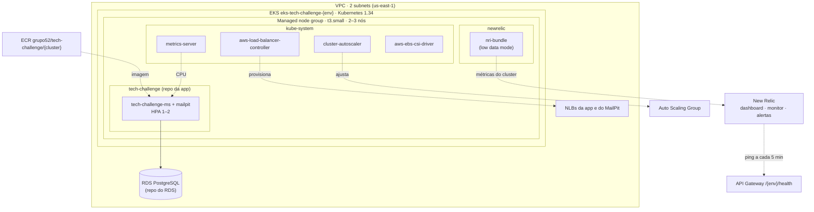

# g52-infra-eks-tech-challenge

Terraform do **cluster Kubernetes (Amazon EKS)** do Tech Challenge (Grupo 52): cluster, node group, ECR, add-ons de escalabilidade e a observabilidade do ambiente no **New Relic** (agente de cluster, dashboard, monitor de uptime e alertas). A aplicação que roda no cluster e os manifestos dela ficam no [`g52-app-tech-challenge`](https://github.com/Teplotax/g52-app-tech-challenge).

## Links

| | |
|---|---|
| Documentação da API (Swagger) | https://teplotax.github.io/doc-api-tech-challenge-v1/ |
| Collection Postman/Insomnia | Enviada no PDF de entrega, porque contém CPFs de teste do seed |
| Arquitetura da solução (diagramas, RFCs, ADRs) | [`g52-app-tech-challenge/docs/arquitetura`](https://github.com/Teplotax/g52-app-tech-challenge/tree/main/docs/arquitetura) |
| Pipelines | [GitHub Actions](https://github.com/Teplotax/g52-infra-eks-tech-challenge/actions) |

### Deploys

Todos os ambientes respondem pelo mesmo API Gateway, com um stage por ambiente:

| Ambiente | URL base | Healthcheck |
|---|---|---|
| dev | https://08onkvn4jb.execute-api.us-east-1.amazonaws.com/dev | [`/dev/health`](https://08onkvn4jb.execute-api.us-east-1.amazonaws.com/dev/health) |
| hom | https://08onkvn4jb.execute-api.us-east-1.amazonaws.com/hom | [`/hom/health`](https://08onkvn4jb.execute-api.us-east-1.amazonaws.com/hom/health) |
| prod | https://08onkvn4jb.execute-api.us-east-1.amazonaws.com/prod | [`/prod/health`](https://08onkvn4jb.execute-api.us-east-1.amazonaws.com/prod/health) |

Para economizar, os ambientes ficam desligados quando não estão em uso ([ADR-003](https://github.com/Teplotax/g52-app-tech-challenge/blob/main/docs/arquitetura/adrs/ADR-003-ambientes.md)). O healthcheck mostra se um ambiente está no ar.

## Arquitetura



| Recurso | Descrição |
|---|---|
| `module.eks` (`terraform-aws-modules/eks/aws` v21) | Cluster EKS, managed node group `t3.small` (AL2023, min 2, máx 3) e add-ons `coredns`, `kube-proxy` e `vpc-cni`. O acesso ao console fica liberado para os usuários de `console_user_arn` |
| `aws_ecr_repository.app` | Repositório `grupo52/tech-challenge/<cluster_name>`, com scan de imagens |
| `helm_release.aws_load_balancer_controller` + role IRSA | Cria uma NLB para cada `Service type: LoadBalancer` da app |
| `helm_release.metrics_server` | Métricas de CPU e memória usadas pelo HPA |
| `helm_release.cluster_autoscaler` + role IRSA | Ajusta o node group quando há pods `Pending` (ex.: a segunda réplica do HPA) |
| `aws_eks_addon.ebs_csi_driver` + `kubernetes_storage_class.gp3` | Volumes EBS (`gp3` como StorageClass padrão) |
| `aws_ec2_tag` | Tags de descoberta das subnets. A tag `kubernetes.io/role/elb` é gerenciada só pelo dev (`tag_subnets_for_elb`) |
| `data.aws_security_group.rds_clients` | SG de clientes do RDS, anexado aos nós para a app alcançar o banco |
| `helm_release.newrelic` | `nri-bundle`, só quando há `NEW_RELIC_LICENSE_KEY` |
| `infra/newrelic.tf` | Dashboard, monitor e alertas, só quando há `NEW_RELIC_API_KEY` (detalhes abaixo) |

## Tecnologias

Terraform (providers `aws`, `kubernetes`, `helm` e `newrelic`), Amazon EKS, EC2 Auto Scaling, ECR, IAM (IRSA), Helm, New Relic e GitHub Actions com OIDC.

## Estrutura

```
infra/
├── main.tf                  # EKS, node group, ECR, IRSA, LB Controller, metrics-server, Cluster Autoscaler, EBS CSI, nri-bundle
├── newrelic.tf              # dashboard, monitor de uptime, policy e condições de alerta
├── dashboard.json.tftpl     # template do dashboard (4 páginas)
├── variables.tf / locals.tf / outputs.tf / providers.tf
├── iam/aws-load-balancer-controller-policy.json
└── inventories/{dev,hom,prod}/terraform.tfvars
```

## Execução manual

Pré-requisitos: Terraform >= 1.6, AWS CLI autenticado na conta e o RDS do ambiente já criado (os nós anexam o SG de clientes dele).

```bash
cd infra
terraform init -reconfigure \
  -backend-config="bucket=g52-terraform-state-dev-<account-id>" \
  -backend-config="key=dev/eks-tech-challenge-dev/terraform.tfstate" \
  -backend-config="region=us-east-1"

terraform plan  -var-file=inventories/dev/terraform.tfvars
terraform apply -var-file=inventories/dev/terraform.tfvars

aws eks update-kubeconfig --name eks-tech-challenge-dev --region us-east-1
kubectl get nodes
```

Os recursos do New Relic só são criados se as variáveis `newrelic_license_key` e `newrelic_api_key` forem passadas (`TF_VAR_...`). No pipeline, elas vêm dos secrets do ambiente.

### Variáveis principais

| Variável | Descrição |
|---|---|
| `cluster_name`, `environment` | Nome do cluster (`eks-tech-challenge-<ambiente>`) e do ambiente |
| `kubernetes_version` | Versão do Kubernetes (`1.34`) |
| `subnet_ids` | Subnets do cluster e do node group |
| `console_user_arn` | Usuários IAM com acesso de admin ao cluster |
| `rds_clients_security_group_name` | SG de clientes do RDS do ambiente |
| `tag_subnets_for_elb` | `true` só no dev (a tag de subnet é compartilhada pelos três ambientes) |
| `newrelic_license_key` / `newrelic_api_key` / `newrelic_alert_email` | Ingestão, Terraform do New Relic e e-mail opcional dos alertas |
| `api_name` | Nome do REST API, usado para montar a URL do monitor de uptime |
| `destroy` | `true` faz o pipeline executar `terraform destroy` |

### Outputs

`cluster_name`, `cluster_endpoint`, `cluster_certificate_authority_data`, `oidc_provider_arn`, `lb_controller_role_arn`, `ebs_csi_role_arn`, `cluster_autoscaler_role_arn` e `app_repository_url`.

## Observabilidade (New Relic)

Quando o ambiente do GitHub tem o secret `NEW_RELIC_LICENSE_KEY`, o Terraform instala o `nri-bundle` no namespace `newrelic`. Ele coleta CPU, memória, pods, nós, eventos e o estado dos objetos do cluster. Para caber no plano gratuito (100 GB/mês), roda com `lowDataMode` e sem `logging` e `prometheus`. Os logs da app vão pelo agente Java, já ligados aos traces.

Quando o ambiente também tem o secret `NEW_RELIC_API_KEY` (uma **User key**, `NRAK-...`), o Terraform cria, por ambiente:

| Recurso | Descrição |
|---|---|
| Dashboard `G52 Tech Challenge (<ambiente>)` | **Ordens de serviço** (volume diário, tempo médio por status, falhas de integração), **APIs e app** (latência, erro, throughput, healthcheck, logs de erro), **Rotas** (hits, sucesso, 4xx, 5xx e taxas por rota) e **Kubernetes** |
| Monitor `g52 health (<ambiente>)` | Ping a cada 5 min no `GET /<ambiente>/health` do API Gateway. Monitores do tipo ping não contam na cota de checks sintéticos |
| Policy `G52 Tech Challenge (<ambiente>)` | Falha no processamento de OS (5xx nas rotas de OS), falha de integração (e-mail/PDF), erros na Lambda de autenticação, latência p95 > 2 s, taxa de erro > 5% e app fora do ar |
| Notificação por e-mail | Só se `newrelic_alert_email` estiver preenchido. Sem e-mail, os alertas abrem *issues* no New Relic |

Esses recursos são criados e destruídos junto com o ambiente. As métricas de Lambda, API Gateway e RDS chegam pela integração AWS do New Relic, cuja role fica no [`g52-infra-gateway-tech-challenge`](https://github.com/Teplotax/g52-infra-gateway-tech-challenge). Decisão registrada no [ADR-005](https://github.com/Teplotax/g52-app-tech-challenge/blob/main/docs/arquitetura/adrs/ADR-005-observabilidade.md).

## Deploy (CI/CD)

```
feature/** -> develop -> release/vX.X.X -> main
```

| Workflow | Gatilho | Ação |
|---|---|---|
| `1 - [FEAT] Build & PR` | Push em `feature/**` | Abre PR automático para `develop` |
| `2 - [DEV] Build and Deploy` | Merge em `develop` | Deploy em **dev** (`apply` ou `destroy`); cria a branch e o PR `release/vX.X.X` |
| `3 - [HOM] Deploy & Promote` | Merge do PR em `release/**` | Deploy em **hom** e abre o PR da release para `main` |
| `5 - [PROD] Deploy` | Merge em `main` | Deploy em **prod** |
| `Deploy` (`deploy.yml`) | Chamado pelos anteriores | Deploy reutilizável, parametrizado por ambiente |

Os workflows não rodam na abertura de PR, só no merge. A autenticação na AWS é via **OIDC** (role `github-actions-terraform-dev`), sem chaves estáticas.

### Ambientes

| Ambiente | Branch | `destroy` padrão | Configuração |
|---|---|---|---|
| **dev** | `develop` | `true` (sobe só quando precisa) | `infra/inventories/dev` (`eks-tech-challenge-dev`) |
| **hom** | `release/*` | `false` | `infra/inventories/hom` (`eks-tech-challenge-hom`) |
| **prod** | `main` | `true` (ligado só para a demonstração) | `infra/inventories/prod` (`eks-tech-challenge-prod`) |

Cada ambiente usa o GitHub Environment de mesmo nome, com a variável `AWS_ACCOUNT_ID` e os secrets `NEW_RELIC_LICENSE_KEY` e `NEW_RELIC_API_KEY`. O state fica no bucket `g52-terraform-state-dev-<account>`, na chave `<ambiente>/...`. A branch `main` é protegida: não aceita push direto, e o merge só acontece por Pull Request.

**Ordem:** o RDS precisa existir antes do `apply` deste repositório, e a app sobe depois dele. No destroy a ordem é inversa: app → Lambda → EKS → RDS.

Os três clusters usam as mesmas subnets. Os Services da app informam as subnets das NLBs pela annotation `aws-load-balancer-subnets`, então o destroy de um ambiente não afeta os outros.

## Repositórios do projeto

| Repositório | Conteúdo |
|---|---|
| [g52-app-tech-challenge](https://github.com/Teplotax/g52-app-tech-challenge) | Aplicação Spring Boot, manifestos Kubernetes e documentação de arquitetura |
| [g52-lambda-tech-challenge](https://github.com/Teplotax/g52-lambda-tech-challenge) | Function Serverless de autenticação (CPF e `client_credentials`) e Lambda Authorizer |
| **g52-infra-eks-tech-challenge** (este) | Cluster EKS, ECR, add-ons e observabilidade (New Relic) |
| [g52-infra-rds-tech-challenge](https://github.com/Teplotax/g52-infra-rds-tech-challenge) | Banco gerenciado (RDS PostgreSQL) e modelo de dados |
| [g52-infra-gateway-tech-challenge](https://github.com/Teplotax/g52-infra-gateway-tech-challenge) | REST API do API Gateway e roles da conta |
| [g52-api-tech-challenge-v1-ext](https://github.com/Teplotax/g52-api-tech-challenge-v1-ext) | Contrato OpenAPI importado no API Gateway (stages dev/hom/prod) |
| [doc-api-tech-challenge-v1](https://github.com/Teplotax/doc-api-tech-challenge-v1) | Swagger publicado no GitHub Pages |
